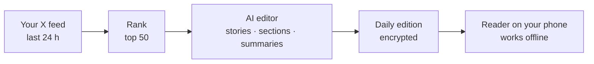

# Diario

**Your social feed, printed once a day.**

Diario collects the most relevant posts of the last 24 hours and turns them into a black-and-white newspaper you can read on your phone, even offline. 50 posts, and then the edition ends.

> 🚧 **Early development.** The design prototype is done and the MVP backlog is defined. Nothing runs automatically yet.

## What it looks like

Open [`design/prototype.html`](design/prototype.html) in a browser to see the design with fictional sample data: a '90s-style tabloid with a front page, sections, story summaries with the related posts, a humor page and a social page.

## How it will work

1. **Collect** — a scheduled GitHub Action reads your X home timeline, trending searches and the weather.
2. **Rank** — posts are scored by engagement relative to account size and by recency; the top 50 make the cut.
3. **Edit** — an AI editor assigns sections, groups related posts into stories and writes headlines and summaries using only what the posts say.
4. **Print** — photos become black-and-white halftone; the edition is validated and encrypted.
5. **Read** — open Diario from your home screen; it stays available offline until the next edition.

## Repository layout

| Path | Contents |
| --- | --- |
| `web/` | The reader: HTML, CSS and JavaScript (PWA) |
| `pipeline/` | Python pipeline that builds the daily edition |
| `data/` | Generated edition and images |
| `schema/` | JSON Schema for `edition.json` |
| `design/` | Design prototype and visual references |
| `docs/` | Documentation and decision records |
| `.github/workflows/` | Scheduled build and deploy |
| `config.example.yaml` | All the options a fork can customize |

## Local development

For now you only need a browser and a code editor:

1. Clone the repository.
2. Open `design/prototype.html` in your browser, or open the folder in VS Code and use the **Live Server** extension.

Instructions for running the pipeline will be added as it is built.

## Roadmap

The MVP backlog lives in the [GitHub Project](https://github.com/users/prieznik/projects/2), organized in milestones from **E1 · Data contract** to **E11 · Open source readiness**.

The first source is X. Instagram and LinkedIn are not planned because they offer no official API to read a personal feed. Open sources such as Bluesky, Mastodon and RSS are candidates for later.

## License

[MIT](LICENSE)
